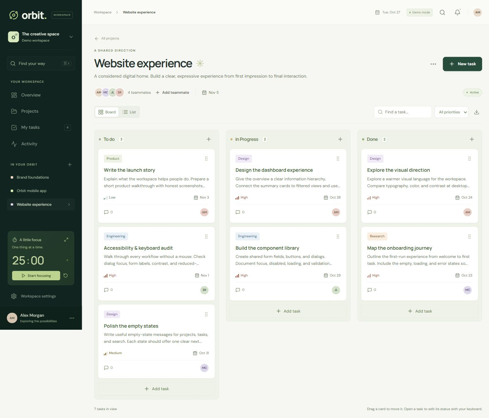

# Orbit — Project Management Workspace

[](https://github.com/devstark7/orbit-workspace/actions/workflows/ci.yml)

**Make space for great work.** A full-stack workspace for organizing projects, coordinating tasks, and understanding team progress. Orbit combines a custom responsive interface with server-enforced project permissions, persistent activity history, and reliable task updates.

**React 19 · Vite · Express · MongoDB · Motion · dnd-kit**

### Try the demo — no setup or sign-in

**[Open the interactive Orbit demo →](https://orbit-workspace-devstark7.redroot4097.chatgpt.site)**

The hosted demo opens straight into a sample workspace. Create tasks, change statuses, add comments, search, and export CSV. A built-in two-minute review guide and reset button make it easy to explore.

**Demo scope:** the hosted preview stores changes in your browser. It does not connect to the Express/MongoDB server or exercise real authentication and multi-user authorization. Both backend and frontend source are included here; follow Quick start to run the complete application.



[Overview screenshot](docs/screenshots/overview.png) · [Mobile screenshot](docs/screenshots/mobile-board.png) · [Welcome screenshot](docs/screenshots/welcome.png)

## Quick start

Requires **Node.js 22.12 or newer** and npm. Node 24 is recommended.

```sh
git clone https://github.com/devstark7/orbit-workspace.git
cd orbit-workspace
npm ci
npm run dev
```

Open **http://127.0.0.1:5173** and select **Explore the live demo**. The API runs on port **5000**. Both frontend and backend are included in this repository.

No account, paid API, or environment file is required for the local demo. Each demo session receives an isolated workspace containing three projects, fifteen tasks, fictional teammates, and sample activity.

**Local demo storage is temporary.** Without `MONGO_URI`, the API starts an in-memory MongoDB replica set; stopping the API resets its data. The first start requires internet access to download an official MongoDB binary. Demo records expire after 24 hours when using persistent storage.

## Explore in two minutes

1. Open the demo and review project progress on **Overview**.
2. Open a project, create a task with an assignee and due date, and drag it to another status.
3. Open the task, add a comment, and reload to confirm it was saved.
4. Switch between board and table views, filter tasks, and export the visible results to CSV.
5. Try `Ctrl/⌘ K` for search, `N` for a new task, and the focus timer. Resize to a mobile viewport to explore the navigation drawer.

## Features

| Area         | Included                                                                                                         |
| ------------ | ---------------------------------------------------------------------------------------------------------------- |
| Projects     | Create and edit projects, track progress, add existing users by email, and manage project membership             |
| Tasks        | Board and table views, drag-and-drop status changes, priorities, assignees, due dates, comments, and deletion    |
| Insights     | Task totals, overdue work, completion history, and a persisted activity feed                                     |
| Productivity | Workspace search, filters, CSV export, keyboard shortcuts, and a focus/break timer                               |
| Interface    | Custom orbital artwork, locally hosted fonts, animated transitions, compact mode, and reduced-motion support     |
| Access       | Registration, sign-in, cookie-based sessions, project membership checks, and owner-controlled project management |

Adding an existing account to a project does not send an invitation email. Demo teammates are fictional.

## Engineering decisions

- **Authorization lives on the server.** Task routes check membership in the parent project. Public registration always creates a Member; submitted role fields cannot grant administrative access.
- **Related writes commit together.** MongoDB transactions keep project/task mutations and activity records consistent. Failed audit writes roll back the operation.
- **Task retries are safe.** A repeated task-creation request with the same ID and details returns the existing task. Reusing that ID with different details is rejected.
- **Deadlines are calendar dates.** Due dates retain their intended day across timezones; completion timestamps remain actual instants.
- **Sessions use HTTP-only cookies.** Production cookies are Secure; logout revokes the user's existing sessions. Passwords are hashed with bcrypt.
- **Startup checks dependencies.** The server waits for its database and indexes, rejects standalone MongoDB, and shuts down gracefully.

The interface uses a deep green sidebar, warm neutral canvas, lime accents, and CSS-built illustrations. Dialogs trap and restore focus, forms have labels, status has text labels, and drag-and-drop has a status-selector alternative. System reduced-motion preferences are respected.

## Technology

| Layer          | Tools                                                               |
| -------------- | ------------------------------------------------------------------- |
| Frontend       | React 19, Vite, Motion, dnd-kit, custom layered CSS                 |
| Backend        | Node.js, Express, Mongoose 8                                        |
| Database       | MongoDB replica set; temporary replica set for local demos          |
| Authentication | JWT sessions in HTTP-only cookies, bcrypt password hashing          |
| Verification   | Node test runner, Supertest, mongodb-memory-server, GitHub Actions  |
| Tooling        | npm workspaces, Prettier, Docker and cloud deployment configuration |

## Persistent storage and configuration

Copy the environment template:

```powershell
Copy-Item backend/.env.example backend/.env
```

On macOS or Linux, use `cp backend/.env.example backend/.env`.

Set `MONGO_URI` to a **MongoDB replica set or MongoDB Atlas** connection string. Transactions are required; standalone MongoDB is not supported. Keep `.env` out of version control.

| Variable        | Local development                        | Production                                        |
| --------------- | ---------------------------------------- | ------------------------------------------------- |
| `MONGO_URI`     | Optional; temporary database when absent | Required; persistent replica set                  |
| `JWT_SECRET`    | Generated in memory when absent          | Required; random secret of at least 32 characters |
| `CLIENT_ORIGIN` | `http://127.0.0.1:5173`                  | Exact HTTPS app origin, without a trailing slash  |
| `PORT`          | `5000`                                   | Hosting provider's port                           |
| `HOST`          | `127.0.0.1`                              | `0.0.0.0` for hosted services                     |
| `NODE_ENV`      | Unset                                    | `production`                                      |
| `ENABLE_DEMO`   | Demo enabled                             | Set `true` explicitly to enable demos             |
| `TRUST_PROXY`   | Unset                                    | `1` only behind one trusted reverse proxy         |

Generate a signing secret locally and store it in your hosting provider's secret settings:

```sh
node -e "console.log(require('node:crypto').randomBytes(48).toString('hex'))"
```

### Local MongoDB with Docker

```sh
docker compose up -d
docker compose ps
```

Once MongoDB reports healthy, set the following in `backend/.env` and restart the development server:

```dotenv
MONGO_URI=mongodb://127.0.0.1:27017/orbit?replicaSet=rs0&directConnection=true
```

The supplied single-node replica set is intended for local development.

## Checks and test coverage

```sh
npm test
npm run build
npm run format:check
```

The verified suite contains **48 passing tests: 27 API tests and 21 frontend tests**. GitHub Actions runs the automated checks; the badge above links to the current workflow.

Coverage includes:

- Project membership boundaries, owner/member permissions, cross-project access attempts, invalid input, and session revocation.
- Transaction rollback after injected failures, including cascading project deletion.
- Sequential and concurrent duplicate task submissions.
- Filtering, completion summaries, CSV escaping, and stable submission keys.
- Calendar deadlines in five timezones, including UTC+14 and a daylight-saving boundary.

Desktop and mobile browser checks covered demo entry, CRUD flows, comments, persisted drag-and-drop changes, search, export, and responsive navigation. See [the verification record](docs/VERIFICATION.md) for evidence and remaining limits.

## Production setup

Configure the production environment variables above, then run:

```sh
npm ci
npm run build
npm start
```

Express serves the built frontend and `/api` from one origin. HTTPS is required for production session cookies.

This repository includes a `Dockerfile`, `render.yaml`, and `railway.json`. Supply a persistent MongoDB replica set and the correct deployed origin before deploying the full-stack application. The public browser demo above is deployed separately as static assets. Docker and full-stack cloud configuration have not been exercised in the verification environment.

To build the same browser-only preview locally in PowerShell:

```powershell
$env:VITE_BROWSER_DEMO = 'true'
npm run build
Remove-Item Env:VITE_BROWSER_DEMO
npm run preview -w frontend
```

Without that build flag, the application uses the real `/api` backend. The demo adapter is a presentation aid, not an authentication or authorization implementation.

## Project structure

```text
backend/
  app.js                 Middleware, routes, and error handling
  server.js              Database-first startup and graceful shutdown
  controllers/           Authentication, project, and task actions
  lib/                   Validation, authorization, and transactions
  models/                Schemas and indexes
  seed.js                Isolated fictional demo workspaces
  tests/                 API integration and reliability regressions
frontend/
  src/OrbitApp.jsx        Workspace state and server actions
  src/components/        Overview, board, forms, search, settings, and navigation
  src/lib/               API client, task calculations, and retry keys
  src/styles/            Layered interface and responsive styles
  tests/                 Domain and timezone regressions
docs/
  screenshots/           Actual application captures
  ARCHITECTURE.md         Data flow, permission model, and tradeoffs
  VERIFICATION.md         Checks performed and verification limits
  INTERVIEW_GUIDE.md      Technical walkthrough and discussion prompts
```

## Documentation and limitations

- [Architecture and design decisions](docs/ARCHITECTURE.md)
- [Verification record](docs/VERIFICATION.md)
- [Technical walkthrough](docs/INTERVIEW_GUIDE.md)

Rate limits are process-local; multiple application instances need a shared limiter store. Email verification, password reset, WebSocket synchronization, and production monitoring are not implemented. Production load capacity, uptime, and formal accessibility compliance have not been established.

## Origin and license

Orbit evolves the account owner's earlier `Devcomplexity/team-task-manager` project. The rebuild replaces the interface, build tooling, authentication flow, and permission handling. This repository imports the source and records the rebuild; it does not preserve the earlier repository's commit history.

Demo names, tasks, and activity are fictional and do not represent clients or usage metrics.

Released under the [MIT License](LICENSE).
