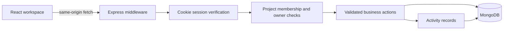
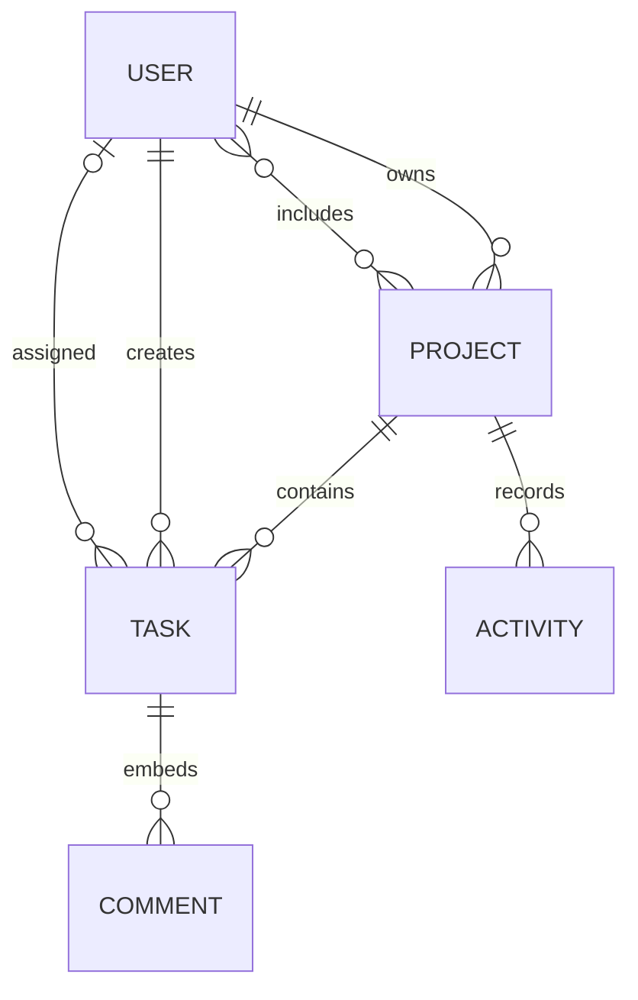

# How Orbit works

## One origin, two development processes

Development runs Vite on port 5173 and Express on port 5000. Vite proxies `/api` to Express. Production uses Express to serve the compiled frontend and API together. This keeps cookies and origin checks straightforward and avoids a second public API deployment.

## Data model

- **User:** normalized email, bcrypt hash (excluded from ordinary queries), display name, session version, and optional demo expiry.
- **Project:** owner, members, status, color, target date, and optional demo expiry. Owner and member fields are indexed.
- **Task:** parent project, author, optional assignee, status, priority, due date, completion timestamp, category, and bounded embedded comments. Project/status is indexed.
- **Activity:** project, actor, action, subject, timestamp. Queries are bounded to the user’s projects and the latest 40 events.

## Authorization

The server is the authority. A hidden button or route in React is not a permission boundary.

| Action                        | Owner | Project member      | Outsider |
| ----------------------------- | ----- | ------------------- | -------- |
| Read project, tasks, activity | Yes   | Yes                 | No       |
| Create/update task, comment   | Yes   | Yes                 | No       |
| Edit project or add members   | Yes   | No                  | No       |
| Delete a task                 | Yes   | Only if its creator | No       |
| Delete project                | Yes   | No                  | No       |

Public signup ignores `role`. The existing role field remains for source continuity, but even an Admin cannot bypass project membership. A requested project ID is validated and authorized before task filtering. Assignees must be the owner or a member of that project.

JWTs contain only user ID and session version, expire in eight hours, and are sent in an HTTP-only SameSite=Lax cookie. Production marks it Secure. Logout increments the session version, revoking that user’s outstanding sessions, then clears the cookie. No session token is put in localStorage.

Helmet supplies security headers. JSON payloads are limited to 32 KB. Cross-origin mutation requests are rejected, alongside SameSite protection. Sign-in/signup, demo creation, and authenticated API traffic have distinct rate limits. Explicit assignments to model fields prevent role and ownership mass assignment.

## Frontend state and mutation

The top-level workspace owns user identity, projects, tasks, and activity. API access is isolated in a small fetch client. Statistics, search/filter rules, CSV escaping, and chart bucketing are pure functions with direct tests.

Task moves update the board optimistically. A per-task in-flight guard prevents overlapping moves, then the client reloads authoritative server data. A failed write reloads data and displays an error. Other actions wait for the server before closing their dialogs. Loading, empty, and failed-fetch states are explicit.

The client is deliberately small: no global state library, analytics tracker, paid AI service, or decorative chart dependency. Motion handles transitions; dnd-kit handles pointer drag. Keyboard users can change the same status in a labeled selector. Fonts are bundled locally. The orbital artwork is CSS and SVG.

## Demo lifecycle

`POST /api/auth/demo` creates a fresh fictional account and colleagues, three private projects, fifteen tasks, and illustrative audit entries. All demo documents carry a 24-hour TTL field. MongoDB TTL deletion is asynchronous, so expiry is also checked during authentication. Demo users cannot add real accounts as members.

Development without `MONGO_URI` starts a real temporary MongoDB process using `mongodb-memory-server`, and waits for connectivity before listening. That database resets on process shutdown. Production never silently falls back to temporary storage.

## Deliberate limits and next steps

- **Not realtime:** a mutation refreshes the author’s view; other users refresh to see updates. A future WebSocket/SSE channel would need project-scoped subscriptions.
- **Single-service rate limiting:** default in-memory counters do not span replicas. Use Redis or an equivalent shared store before scaling horizontally.
- **Bounded portfolio data:** lists load the workspace together. Add cursor pagination and server-side search for large teams.
- **No email delivery:** adding a known user by email grants membership. This is not an emailed invitation workflow. Password reset and email verification require an email provider and abuse controls.
- **No distributed transactions:** related records are changed sequentially. For stronger crash/race guarantees, use MongoDB replica-set transactions, particularly around cascading project deletion and audit writes.
- **Basic session lifecycle:** signing-secret rotation invalidates sessions. Logout revokes all sessions for the user; per-device session management is future work.
- **Audit scope:** the feed records product actions, not a tamper-proof compliance log. Demo entries are fictional seed data.
- **Hosting:** containers and deployment configuration are provided; they must be exercised against the actual hosting provider before claiming a live deployment.

## Improvements over the starting project

The source import began with React/CRA and Express/MongoDB. It had public role selection, task disclosure through a supplied project ID, localStorage tokens, incomplete setup instructions, and no regression suite. Orbit replaces those paths, removes stale build artifacts and unused routes, updates to a workspace/Vite build, adds isolated demos, and implements a cohesive responsive interface.
